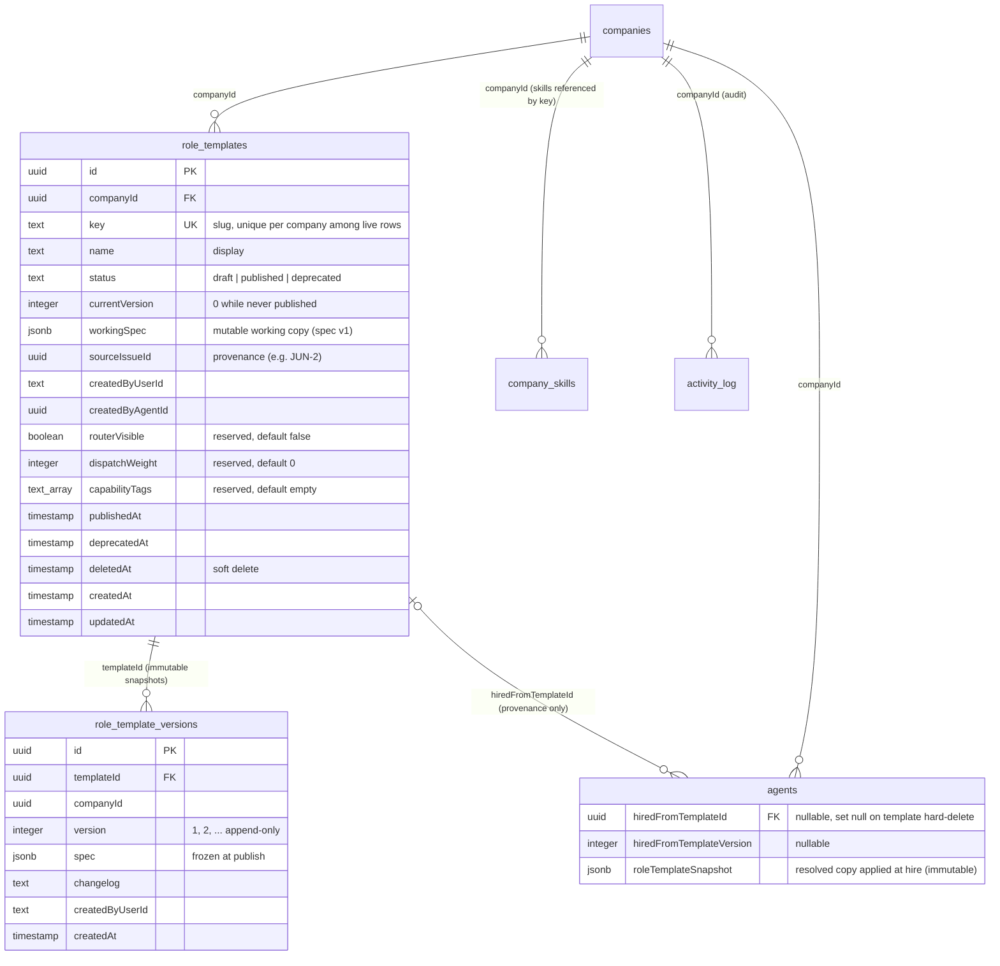
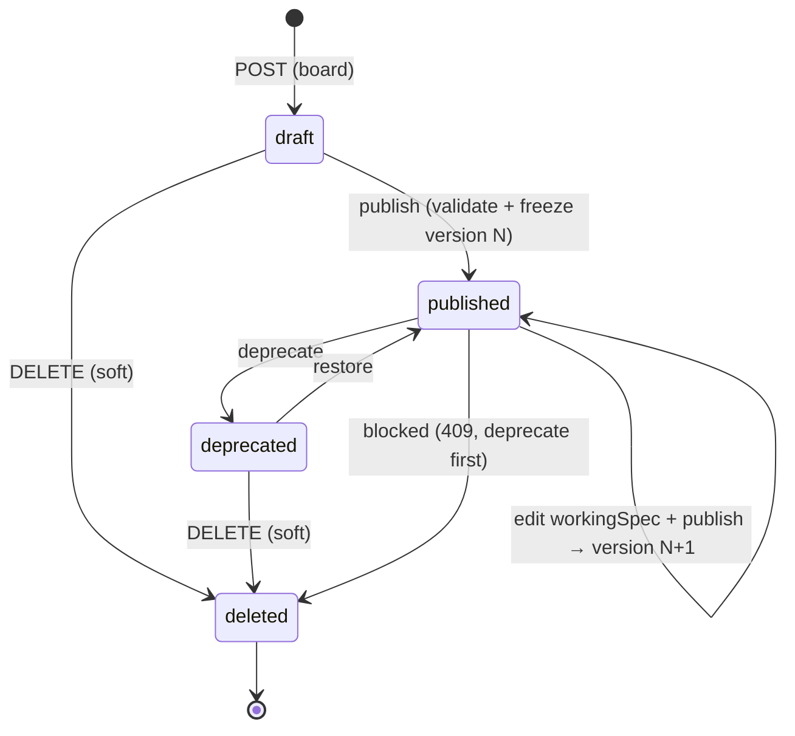
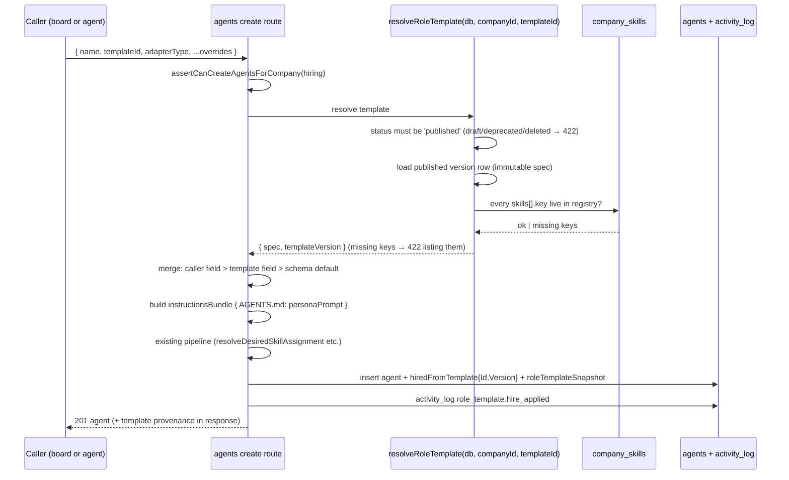

# Role Template System — Design

| | |
|---|---|
| **Status** | Proposed (design only — no implementation in this phase) |
| **Date** | 2026-11-18 |
| **Scope** | `role_templates` storage, admin API, agent-hire wiring |
| **Evidence** | Two templates produced and accepted through real agent runs: [JUN-2](/JUN/issues/JUN-2) (content marketing, accepted), [JUN-3](/JUN/issues/JUN-3) (software engineer, accepted) |
| **Out of scope** | Changes to `AGENT_ROLES`, `server/src/authorization.ts`, or the router/dispatcher itself |

---

## 1. Problem and scope

Hiring a Paperclip agent today is an unstructured act: the caller of
`POST /api/companies/:companyId/agents` assembles `capabilities`,
`desiredSkills` and an `instructionsBundle` by hand every time. Two
consequences:

1. **No reuse.** Every "content marketing specialist" hire re-derives the
   persona prompt, skill set and budget from scratch; quality depends on who
   typed the request.
2. **No governance surface.** There is nothing reviewable, versionable or
   deprecatable between "a person had a good idea" and "the agent exists".

A **role template** packages the validated answers — persona, skills,
defaults, rationale — into a versioned, publishable company asset. Hiring
becomes "apply template, override what differs".

Real-world validation already exists. An agent acting as template-designer
produced two templates through the normal issue flow, each confirmed by a
board acceptance card, and both proved the **same five-field schema** fits a
pure-document role and a git-repo role with zero structural changes:

| | v1 — JUN-2 | v2 — JUN-3 |
|---|---|---|
| templateName | 内容营销专员 v1 (content-marketing-specialist) | 研发工程师 v1 (software-engineer) |
| role | `general` | `general` |
| personaPrompt | 3-section format, 548 chars | 3-section format, 543 chars |
| skills | paperclip, para-memory-files, slack, agentmail | paperclip, para-memory-files, github-pr-workflow, qa-acceptance |
| environment | session workspace (no repo) | git-repo workspace, branch isolation |
| budget note | $20–40/mo, low tier | $40–80/mo, mid tier |
| permissions note | no `agents:create`/`skills:create` | repo write + PR, no deploy/secrets |

### Non-goals (this phase)

- **No `AGENT_ROLES` change.** Templates set `role: "general"` today; the enum
  stays exactly as in `packages/shared/src/constants.ts:53`.
- **No authorization-core change.** `server/src/services/authorization.ts` is
  untouched; template admin uses existing board gate helpers only.
- **No retroactive agent management.** Templates configure *new* hires; they
  never rewrite existing agents (§7).
- **No dispatcher.** Routing columns are *reserved*, not consumed (§8).

---

## 2. Background — what the code does today

- **Schema**: `createAgentSchema` (`packages/shared/src/validators/agent.ts:90`)
  carries `name`, `role`, `title`, `capabilities`, `desiredSkills`,
  `instructionsBundle { entryFile, files }`, `budgetMonthlyCents`,
  `permissions`, `defaultEnvironmentId`, `adapterType/adapterConfig/runtimeConfig`.
  Agent-authored hires use `createAgentHireSchema` (`agent.ts:147`).
- **Route**: `POST /api/companies/:companyId/agents`
  (`server/src/routes/agents.ts:4874`) → `assertCanCreateAgentsForCompany(..., { hiring: true })`
  → `resolveDesiredSkillAssignment(...)` + `withDefaultRoleSkillSelections(...)`
  (~`agents.ts:4960`). Non-column body fields are consumed server-side — this
  is the established pattern a `templateId` field will follow.
- **Skills registry**: company skills live in `company_skills`
  (`packages/db/src/schema/company_skills.ts:19`); five core keys in
  `PAPERCLIP_CORE_SKILL_KEYS` (`server/src/services/company-skills.ts:687`).
  `desiredSkills` entries are plain skill keys or `{ key, versionId }`
  (`packages/shared/src/validators/adapter-skills.ts:40`).
- **Auth helpers**: `assertBoard` / `assertBoardOrgAccess` /
  `assertCompanyAccess` (`server/src/routes/authz.ts:168,184,211`); actors are
  `"board"` or `"agent"` (`server/src/middleware/auth.ts:239`).
- **Conventions**: Drizzle + PostgreSQL, UUID PKs, `jsonb` payloads,
  `deletedAt` soft delete, `activity_log` audit
  (`packages/db/src/schema/activity_log.ts`), numbered SQL migrations in
  `packages/db/src/migrations/` (next free number at write time: 0489).

---

## 3. Template spec v1 (refined from the validated output)

The two accepted deliverables share
`{ templateName, character{personaPrompt,title,role}, skills[{key,reason}], defaults{notes}, rationale[] }`.
One refinement is needed for machine application: the validated `defaults`
packed model/budget/environment/concurrency/permissions into free text. The
canonical schema keeps the free-text `notes` but lifts the machine-readable
parts into typed fields (seed files in §5.5 show the normalized result):

```ts
// packages/shared/src/validators/role-template.ts  (proposed)

export const roleTemplateSpecSchema = z.object({
  templateName: z.string().trim().min(1).max(120),          // display name
  character: z.object({
    // Three-section convention validated in practice: 职责边界 / 工作风格 / 输出规范.
    // Hard cap 1200 chars (validated deliverables: 548 and 543).
    personaPrompt: z.string().trim().min(200).max(1200),
    title: z.string().trim().min(1).max(80),                // becomes agent title
    role: z.enum(AGENT_ROLES).default("general"),           // enum unchanged
  }),
  skills: z.array(z.object({
    key: z.string().min(1).max(256),                        // company_skills.key
    reason: z.string().trim().min(1).max(400),              // why this role needs it
  })).min(1).max(10),                                       // unique keys (superRefine)
  defaults: z.object({
    modelHint: z.string().max(120).optional(),              // advisory, not applied
    budgetMonthlyCents: z.number().int().min(0).max(2_000_000).optional(),
    environmentKind: z.enum(["session", "git_repo"]).optional(),
    maxConcurrentRuns: z.number().int().min(1).max(4).optional(), // advisory
    permissions: z.object({                                 // subset of agentPermissionsSchema
      canCreateAgents: z.boolean().optional(),
      canCreateSkills: z.boolean().optional(),
    }).optional(),
    notes: z.string().max(2000).optional(),                 // human remainder
  }),
  rationale: z.array(z.string().max(600)).max(8),           // editorial record, not applied
});
```

Notes:

- `modelHint` and `maxConcurrentRuns` are **advisory metadata** surfaced in
  the hire UI. They deliberately do not map to `runtimeConfig`/
  `adapterConfig`, which are company-specific bindings the caller still owns.
- `rationale` is preserved verbatim from the design deliverables; it documents
  *why* the template looks like this and never participates in hire
  resolution.
- `environmentKind` guides the hire UI (whether a repo workspace must be
  selected) but does not create environments itself.

---

## 4. Data model



### 4.1 Design decisions

**Versioning — mutable parent + immutable published versions.**
`role_templates.workingSpec` is the editable draft; `publish` freezes it into
an append-only `role_template_versions` row and bumps `currentVersion`. Hires
resolve **only** against version rows, never `workingSpec`, so a mid-edit
template can never produce a half-edited hire. This mirrors the proven
`company_skills.currentVersionId` pattern but lighter: drafts iterate in
place (no version churn while a template is unpublished), and every published
state is permanent for audit. Re-publishing a published template creates
version N+1; already-issued hires keep pointing at the version they used.

**Soft delete.** `deletedAt` timestamp, following `companySkillComments`.
`DELETE` is only permitted on `draft` or `deprecated` rows (§5.4), and a soft-
deleted row is excluded from list/GET/hire resolution. A **partial unique
index** `unique (companyId, key) where deletedAt is null` lets the key be
reused after deletion.

**Audit.** Every mutation writes `activity_log` (`entityType:
"role_template"`, action `role_template.created|updated|published|deprecated|
deleted|hire_applied`), with actor from the request. `role_template_versions`
rows are never updated or deleted — publish-time history is intrinsic.
`sourceIssueId` preserves the design-provenance link (JUN-2/JUN-3 style
deliverables) on the row itself.

**Reserved router columns** (see §8): `routerVisible boolean not null default
false`, `dispatchWeight integer not null default 0`,
`capabilityTags text[] not null default '{}'` with a GIN index. Nothing in
this phase reads or writes them except the admin PATCH.

**DDL sketch** (one migration, `packages/db/src/migrations/0489_role_templates.sql`
at implementation time; `CREATE TABLE` classifies `online_compatible`):

```sql
CREATE TABLE role_templates (
  id uuid PRIMARY KEY DEFAULT gen_random_uuid(),
  company_id uuid NOT NULL REFERENCES companies(id),
  key text NOT NULL,
  name text NOT NULL,
  status text NOT NULL DEFAULT 'draft',
  current_version integer NOT NULL DEFAULT 0,
  working_spec jsonb NOT NULL,
  source_issue_id uuid,
  created_by_user_id text,
  created_by_agent_id uuid,
  router_visible boolean NOT NULL DEFAULT false,
  dispatch_weight integer NOT NULL DEFAULT 0,
  capability_tags text[] NOT NULL DEFAULT '{}',
  published_at timestamptz,
  deprecated_at timestamptz,
  deleted_at timestamptz,
  created_at timestamptz NOT NULL DEFAULT now(),
  updated_at timestamptz NOT NULL DEFAULT now()
);
CREATE UNIQUE INDEX role_templates_company_key_live_idx
  ON role_templates(company_id, key) WHERE deleted_at IS NULL;
CREATE INDEX role_templates_company_status_idx
  ON role_templates(company_id, status) WHERE deleted_at IS NULL;
CREATE INDEX role_templates_capability_tags_idx
  ON role_templates USING gin(capability_tags);

CREATE TABLE role_template_versions (
  id uuid PRIMARY KEY DEFAULT gen_random_uuid(),
  template_id uuid NOT NULL REFERENCES role_templates(id) ON DELETE CASCADE,
  company_id uuid NOT NULL REFERENCES companies(id),
  version integer NOT NULL,
  spec jsonb NOT NULL,
  changelog text,
  created_by_user_id text,
  created_at timestamptz NOT NULL DEFAULT now(),
  UNIQUE (template_id, version)
);

ALTER TABLE agents
  ADD COLUMN hired_from_template_id uuid REFERENCES role_templates(id) ON DELETE SET NULL,
  ADD COLUMN hired_from_template_version integer,
  ADD COLUMN role_template_snapshot jsonb;
CREATE INDEX agents_company_hired_from_template_idx
  ON agents(company_id, hired_from_template_id);
```

### 4.2 Why snapshot on `agents` rather than only a reference

The three new `agents` columns encode the copy-on-hire policy structurally:

- `hiredFromTemplateId`/`hiredFromTemplateVersion` — provenance for stats,
  roster display and the future router. Because versions are immutable, the
  pair always resolves to exactly what was applied.
- `roleTemplateSnapshot` — the **resolved application record** (§6.4): the
  merged spec actually used, including caller overrides and any warnings.
  This survives even if the template row is later soft-deleted, and makes the
  hire self-describing without joins. A nullable FK alone cannot do either.

---

## 5. Admin API

All routes under `/api`, company-scoped, validated with `validate(schema)`
middleware and registered as a route factory in `server/src/app.ts`
(following `companySkillRoutes`).

### 5.1 Endpoints

| Method | Path | Actor | Purpose |
|---|---|---|---|
| GET | `/companies/:companyId/role-templates` | board, agent | List; `?status=`, `?includeDeleted=` (board only). Agents see `published` only. |
| GET | `/companies/:companyId/role-templates/:templateId` | board, agent | Detail incl. version history (agents: published version only). |
| POST | `/companies/:companyId/role-templates` | board | Create **draft** from spec (+ optional `key`, `sourceIssueId`). |
| PATCH | `/companies/:companyId/role-templates/:templateId` | board | Edit `workingSpec`/`name`/router-reserved fields of a non-deprecated row. Draft or published both allowed (published requires republish to take effect). |
| POST | `…/role-templates/:templateId/publish` | board | Validate → freeze `workingSpec` as version `currentVersion+1` → `status=published`. |
| POST | `…/role-templates/:templateId/deprecate` | board | `published → deprecated`. Existing hires unaffected (§7). |
| POST | `…/role-templates/:templateId/restore` | board | `deprecated → published` (resume hiring at latest version). |
| DELETE | `…/role-templates/:templateId` | board | Soft delete; rejected for `published` rows (deprecate first). |
| POST | `/companies/:companyId/role-templates/install-seeds` | board | Idempotent seed install for existing companies (§5.4). |

### 5.2 Authorization — board-only writes, agent-readable published set

- **Writes (create/patch/publish/deprecate/restore/delete/install-seeds)**:
  `assertCompanyAccess` + `assertBoardOrgAccess` — board-only, exactly like
  other board control surfaces, using the existing
  `boardAccessRequired()` denial with remediation so agents hand the step to
  a person instead of hunting for another route. Rationale: a template
  silently configures persona + permissions + budget for every future hire —
  that is organizational governance, the same class as budget approval.
- **Reads**: board sees everything; company agents see `published` templates
  and their published version. Agents need read access because
  `canCreateAgents`-empowered agents hire via `templateId` (§6.1), and because
  suggesting "hire from template X" is a normal agent recommendation.
- The `ceo` special-cases in the authorization core are untouched; a CEO
  agent is treated like any other agent here.

This matches how the two seed templates were actually ratified: the
template-designer *agent* produced the JSON on an issue, and a *board* user
accepted it via confirmation card. The API formalizes that split — agents
author and propose, the board owns the lifecycle.

### 5.3 Idempotency

- `POST` create honors an `Idempotency-Key` header (24 h dedupe window,
  same-body replay returns the original row, different body → `409`) — same
  convention as other company-scoped create routes.
- `publish`/`deprecate`/`restore` are naturally idempotent state transitions:
  re-invoking in the target state returns `200` with the current row.
  - **Publish after an edit is NOT a retry**: `publish` on a `published` row
    whose `workingSpec` hash differs from `publishedSpec` creates version
    **N+1** (§4.1, §5.4 flow). A publish call on a `published` row with an
    **unchanged** spec is the only no-op: returns `200` with the current
    version, no new row. The comparison key is the `workingSpec` content
    hash, not the request replay.
- `install-seeds` upserts by `(companyId, key)`: an existing live row with
  the same key is never overwritten; the response reports
  `installed` vs `alreadyPresent` per key. **Exception — gapped-seed
  recovery**: if the existing live row is `deprecated` with
  `deprecationReason = "missing-skills: ..."` (installed with gaps, §5.5)
  and the missing skills now all resolve, the retry **updates that row**
  (clears the deprecation, republishes as a new version). This is the only
  path that overwrites a live row, and it is gated on the recorded gap
  reason so ordinary seeds keep the no-overwrite rule.

### 5.4 Lifecycle



**Publish gate** (all must pass, else `422` with a field list):

1. `workingSpec` parses as `roleTemplateSpecSchema` (§3).
2. Every `skills[].key` **resolves against the company's live skill registry**
   (`company_skills` for this `companyId`). The JUN-3 flow installed
   `github-pr-workflow`/`qa-acceptance` from the bundled catalog *before*
   referencing them — "catalog install → company library → template
   reference" becomes the enforced publish order, eliminating paper
   dependencies at publish time rather than exploding at hire time.
3. `character.role` ∈ `AGENT_ROLES` (enum unchanged).
4. Template `key` (slug) matches `^[a-z0-9][a-z0-9-]{1,62}[a-z0-9]$`.

Hire re-validates skill availability anyway (skills can be uninstalled after
publish — §6.5), so publish is a fast gate, not the only one.

### 5.5 Seed data for the two validated templates

- Seed files live in-repo at `server/src/role-template-seeds/*.json`,
  shape `{ key, spec }` with `spec` matching §3 exactly. The normalized
  content of both accepted deliverables is archived alongside this document:
  - `docs/Design/RoleTemplate/seeds/content-marketing-specialist-v1.json`
  - `docs/Design/RoleTemplate/seeds/software-engineer-v1.json`
  (`personaPrompt`, `skills[].reason` and `rationale` kept **verbatim** from
  the accepted JUN-2/JUN-3 deliverables; `defaults.notes` free text split
  into the typed fields).
- `seedRoleTemplates(companyId, db)` in
  `server/src/services/role-template-seed.ts` upserts both as **published
  version 1** rows (`sourceIssueId` set from the provenance issues) and is
  idempotent by key. **Skill-resolution gate**: if the company lacks any
  catalog skill referenced by a seed, the seed for that template is still
  installed but lands in `deprecated` status with `deprecationReason =
  "missing-skills: <keys>"`; `install-seeds` reports `installedWithGaps` for
  such keys. Re-running `install-seeds` after the missing skills are
  installed re-publishes the row (same upsert path). Hire-time validation
  (§6) remains the hard gate — a gapped template can never produce an agent
  until its skills resolve.
- New companies: invoked from company creation alongside onboarding seeding.
  Existing companies: the board-only `install-seeds` endpoint (§5.1). No
  automatic migration backfill — template installation stays an explicit
  governance act for companies that already exist.

---

## 6. Hire wiring

### 6.1 API change

`createAgentSchema` and `createAgentHireSchema` gain one optional consumed
server-side field (same pattern as `onboardingFirstAgent`):

```ts
templateId: z.string().guid().optional(),
```

`templateId` **requires** `name` from the caller (an agent's name is
instance-specific — a company may hire two marketers from one template).
Omitting `name` with `templateId` present → `422`.

### 6.2 Resolution flow



### 6.3 Field precedence and conflict rules

Principle: **explicit caller value wins; template fills the gaps; schema
defaults apply last.** `undefined` in the request means "not specified"
(templates apply); explicitly provided values always override.

**`role` reads from the RAW request body, before schema defaults.**
`validate()` replaces `req.body` with the parsed output, and
`createAgentSchema` defaults an omitted `role` to `"general"` — so by the
time the handler sees `body.role`, "caller omitted" and "caller sent
`general`" are indistinguishable. Resolution therefore reads `role` from the
pre-validation raw body (`req.rawBody` captured by a pre-validate
diddleware): raw `role` present → caller wins; raw `role` absent → template
`character.role` applies; both absent → schema default `"general"`. The same
rule covers `createAgentHireSchema` (inherits the default). Other defaulted
fields with template sources (`budgetMonthlyCents`) use the same raw-body
check.

| `createAgentSchema` field | Template source | Rule when caller also sets it |
|---|---|---|
| `name` | — (never templated) | caller only, required |
| `title` | `character.title` | caller wins |
| `role` | `character.role` (validated enum) | caller wins |
| `capabilities` | — (not templated in v1) | caller only |
| `instructionsBundle` | built from `character.personaPrompt` as `{ entryFile: "AGENTS.md", files: { "AGENTS.md": personaPrompt } }` | caller-provided bundle **replaces** wholesale (422 if caller passes a partial bundle without entryFile — schema already enforces `files` non-empty) |
| `desiredSkills` | `skills[].key` → selection entries (string form) | **union merge**: template skills ∪ caller skills, caller wins per key; existing `withDefaultRoleSkillSelections` still adds core defaults afterwards |
| `budgetMonthlyCents` | `defaults.budgetMonthlyCents` | caller wins |
| `permissions` | `defaults.permissions` (subset: `canCreateAgents`, `canCreateSkills`) | shallow merge, caller key-level precedence; hire-route board checks on `permissions` still run unchanged |
| `defaultEnvironmentId` | — (advisory `environmentKind` only; UI uses it to prompt) | caller only |
| `adapterType`, `adapterConfig`, `runtimeConfig` | — (company-specific bindings) | caller only |
| `metadata` | — | caller only |

The merge is a pure function `resolveTemplateIntoAgentCreate(spec, body)` —
unit-testable without a server (§9).

### 6.4 Copy-on-hire (the propagation policy)

At hire time the server writes to `agents`:

```jsonc
// roleTemplateSnapshot
{
  "templateKey": "content-marketing-specialist",
  "templateVersion": 1,
  "applied": { "title": "...", "role": "general", "personaPrompt": "...",
               "skills": [{ "key": "...", "reason": "..." }],
               "defaults": { ... } },
  "callerOverrides": ["title", "budgetMonthlyCents"],   // audit of the diff
  "appliedAt": "2026-11-18T..."
}
```

- The snapshot is **immutable after hire**. `PATCH /agents/:id` never touches
  it; it is not part of `updateAgentSchema`.
- Template edits, republishes, deprecation or deletion **never rewrite
  existing agents** — guaranteed structurally (nothing reads the template at
  agent-update time) and recorded as policy (§7).
- `hiredFromTemplateVersion` pins the immutable version row, so roster
  provenance survives even soft deletion of the parent template.

### 6.5 Failure semantics

- `templateId` not found / not `published` / soft-deleted → `422` with
  `code: "role_template_not_hireable"` (message distinguishes nothing —
  same body shape as `issueNotFoundBody`'s information-hiding rationale).
- Any `skills[].key` missing from the live registry at hire time → `422`
  listing the missing keys and the remediation ("install from catalog or
  pick another template"). **Fail closed**: silently hiring a persona
  without its declared skills degrades behavior invisibly.
- Everything downstream (budget checks, hire approvals via
  `/agent-hires`, adapter validation) runs unchanged after merge.

---

## 7. Governance

| Question | Decision |
|---|---|
| Who may create/edit templates? | Board only. Agents author *proposals* (issue documents, as happened in JUN-2/JUN-3) and a board user promotes them through the API. |
| Who may publish/deprecate/restore/delete? | Board only, all transitions audited in `activity_log` with actor and changelog. |
| Who may read? | Board: everything. Agents: published templates + their published version. |
| Can an agent edit a template it authored? | No. Authorship is recorded (`createdByAgentId`), authorship is not authority. |
| Change propagation | **Copy-on-hire only.** No retroactive rewrite of existing agents, in any lifecycle transition, ever. Deprecation stops *new* hires; existing hires keep their snapshot. |
| Template deletion | Soft delete, `draft`/`deprecated` only. Hired agents' snapshots and version rows survive. |
| Budget integrity | Template `budgetMonthlyCents` is a *default*, subject to the same board checks and hire-approval gates as a hand-typed budget. A template can never raise a hire's budget above what the caller could set directly. |

---

## 8. Router readiness (open question — reserved, not implemented)

A future dispatcher agent will route inbound external tasks (e.g. Feishu
messages) to the right hire. The likely read pattern is: *find published,
router-visible templates whose capability tags match the task, ordered by
dispatch weight; route to a matching hire (agents with
`hiredFromTemplateId`), else propose a template hire.* To avoid a schema
migration later, this design reserves — and this phase **does not consume** —
on `role_templates`:

- `routerVisible boolean not null default false` — opt-in per template.
- `dispatchWeight integer not null default 0` — tie-breaking priority.
- `capabilityTags text[] not null default '{}'` + GIN index — matching
  vocabulary (exact taxonomy left to the dispatcher design).

Admin `PATCH` may set them (board-only) so companies can preconfigure; no
read path, no hire behavior, no UI beyond raw fields. `agents.hiredFromTemplateId`
already provides the hire→template join the router will need. Open questions
(tag taxonomy, per-hire vs per-template routing weights, Feishu intent
classification) are deliberately deferred to the dispatcher design doc.

---

## 9. Test plan (unit-level, described)

All pure logic lives in two functions, keeping tests server-free:

1. **`roleTemplateSpecSchema` validation**
   (`packages/shared` — `role-template.test.ts`):
   - both seed JSONs parse; field bounds (personaPrompt 200–1200, skills
     1–10, unique keys); `role` restricted to `AGENT_ROLES`; `defaults`
     numeric bounds; malformed `defaults` (budget as string) rejected.
2. **`resolveTemplateIntoAgentCreate` resolution**
   (`server/src/services/role-template-resolution.test.ts`):
   - precedence: caller > template > schema default for `title`, `role`,
     `budgetMonthlyCents`;
   - `desiredSkills` union merge (caller key wins; core defaults still
     appended downstream);
   - `permissions` shallow merge, caller key-level precedence;
   - caller `instructionsBundle` replaces the persona-derived bundle;
   - missing `name` with `templateId` → error;
   - snapshot content: `callerOverrides` lists exactly the overridden keys.
3. **Lifecycle gate** (`role-template-routes` handler tests with a test DB):
   publish blocked on unresolvable skill key; version rows append-only
   (republish → N+1, prior row byte-identical); DELETE on `published` → 409;
   soft-deleted key reusable; partial unique index honored.
4. **Copy-on-hire immutability** (integration): hire from template v1,
   republish template as v2, `PATCH` the agent — snapshot and
   `hiredFromTemplateVersion` unchanged; deprecating/deleting the template
   leaves the agent fully functional.

---

## 10. Future work (explicitly out of this design)

- Structured `environment`/`model` binding in `defaults` (today advisory).
- Catalog-driven template marketplace / cross-company sharing (the
  `company_skills` sharing-scope machinery is the natural precedent).
- Dispatcher agent + capability-tag taxonomy (§8).
- Template-driven *reconfiguration* of existing agents (requires its own
  governance story — intentionally excluded by copy-on-hire).
- Any `AGENT_ROLES` or authorization-core changes.

## Appendix — provenance

| Artifact | Where |
|---|---|
| Template v1 (content marketing), accepted 2026-11 via confirmation card | [JUN-2](/JUN/issues/JUN-2) document `role-template` |
| Template v2 (software engineer), accepted 2026-11 via confirmation card | [JUN-3](/JUN/issues/JUN-3) document `role-template` |
| Normalized seeds (verbatim persona/reason/rationale) | `docs/Design/RoleTemplate/seeds/*.json` |
